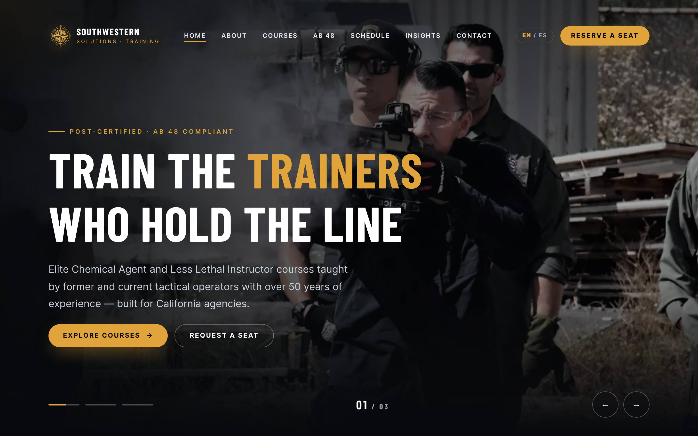

# Southwestern Solutions — Rediseño WordPress completo

Rediseño profesional de **southwesternsolutions.org** (capacitación de instructores policiales certificada por POST en San Diego, CA: *Chemical Agent Instructor*, *Less Lethal Instructor* y cumplimiento *AB 48 / Código Penal 13652*).



## 📦 Qué incluye

| Entregable | Ruta |
|---|---|
| **Tema WordPress** listo para subir (ZIP) | `release/southwestern-solutions-theme.zip` |
| Código fuente del tema | `theme/southwestern-solutions/` |
| **XML de importación** (11 páginas, menú y SEO) | `import/southwestern-solutions.WordPress.xml` |
| **SEO completo página por página (inglés)** | `docs/SEO-STRATEGY.md` |
| **Textos de alto impacto ES / EN (3 versiones por bloque)** + copys de anuncios | `docs/COPY-ES-EN.md` |
| 8 imágenes generadas con IA (Magnific / Freepik), optimizadas WebP + JPG | `theme/southwestern-solutions/assets/img/` |
| Capturas de la versión probada | `docs/preview/` |
| Vista previa estática (Vercel) | `preview-static/` — https://southwestern-solutions-preview.vercel.app |
| Generador del XML (por si editas textos) | `tools/build_wxr.py` |

## ✨ Diseño y efectos

- **Slider panorámico 3D**: tres escenas con transición en profundidad (perspectiva, `rotateY` y `translateZ`). La imagen es más ancha que la pantalla y se desplaza con el cursor (efecto panorámico), con capas de profundidad (parallax), efecto Ken Burns, humo animado, títulos que se revelan línea por línea, barra de progreso, flechas, teclado y swipe en el celular.
- Tarjetas con **inclinación 3D** y reflejo que sigue al cursor, aparición de secciones al hacer scroll, contadores animados, marquesina de credenciales, parallax en los encabezados internos, menú móvil a pantalla completa y botón flotante de llamada.
- Paleta táctica: negro carbón, ámbar dorado y acero. Tipografías Barlow Condensed e Inter.
- Accesible: un solo H1 por página, enlace para saltar al contenido, ARIA en el slider y respeto a `prefers-reduced-motion`.
- Sin jQuery ni plugins de slider (unos 6 KB de JS).

## 🚀 Instalación (10 minutos)

1. **Respalda** el sitio actual (UpdraftPlus o tu hosting).
2. **Apariencia → Temas → Añadir nuevo → Subir tema** → sube `release/southwestern-solutions-theme.zip` → **Activar**.
3. **Herramientas → Importar → WordPress** (instala el importador si te lo pide) → sube `import/southwestern-solutions.WordPress.xml` → asigna el autor → **Enviar**.
4. Entra a cualquier página del admin. El tema configura **automáticamente**:
   - Página de inicio = *Home* (el sitio no tiene blog)
   - Menú principal = *Main Menu*
   - Enlaces permanentes `/%postname%/` (si no estaban configurados)
5. **Apariencia → Personalizar → Business Info**: confirma teléfono, correo, horario y redes sociales.
6. (Opcional) Instala **Rank Math** o **Yoast SEO**. Todos los títulos, descripciones y palabras clave ya vienen cargados en sus campos.
7. Borra la entrada de ejemplo **"Hello world!"** y la página **"Sample Page"** que WordPress crea por defecto.
8. Instala un plugin SMTP (WP Mail SMTP / FluentSMTP) para que el formulario de reservas llegue a `info@southwesternsolutions.org`.

> ⚠️ Si el sitio actual usa WooCommerce, el tema redirige con **301** las URLs antiguas (`/product/...`, `/shop/`, `/home-it-service/`) a las nuevas páginas para conservar el posicionamiento.

## 🧩 Secciones reutilizables (shortcodes)

Puedes armar cualquier página nueva con un bloque *HTML personalizado* o *Shortcode*:

`[sws_slider]` · `[sws_trustbar]` · `[sws_courses]` · `[sws_features]` · `[sws_stats]` · `[sws_process]` · `[sws_split img="hero-2"]…[/sws_split]` · `[sws_cta title="…" text="…" button="…" url="/contact/"]` · `[sws_contact_form]` · `[sws_contact_info]` · `[sws_section eyebrow="…" title="…"]…[/sws_section]`

## ✅ Antes de publicar: verificar con el cliente

Estos datos se tomaron de los resultados de búsqueda del sitio actual y del catálogo POST (no fue posible abrir el sitio ni web.archive.org desde este entorno):

- Precios: **$1,881** (Chemical Agent, 40 h) y **$1,200** (Less Lethal, 30 h).
- Calendario confirmado por el cliente: Chemical Agent 14–18 dic 2026 San Diego (**Sold Out**), Less Lethal 9–11 dic 2026 San Diego (inscripción abierta), Chemical Agent 8–12 feb 2027 San Diego (inscripción abierta).
- Teléfono **+1 (928) 614-0964** y correo **info@southwesternsolutions.org**. El horario (L–V 8–5 PT) es un supuesto razonable.
- La página **Host a Course** describe un servicio que hay que confirmar con el cliente.
- **Fotos reales del cliente** (entrenamiento con lanzador, instructor con telescopio, operación nocturna, recorte SWAT) y el **logo de la rosa de los vientos** ya están integrados. Las imágenes de IA restantes (aula, línea de escudos, máscara, documentos, San Diego) pueden reemplazarse por fotos reales cuando estén disponibles.
- Los textos sobre AB 48 son educativos. Conviene que un abogado de la agencia o del cliente los revise.

## 🖼️ Imágenes generadas (Magnific / Freepik AI)

| Archivo | Uso | Prompt resumido |
|---|---|---|
| hero-1 | Slide 1, curso de agentes químicos | Ejercicio táctico al atardecer en el desierto, oficiales con máscara entre humo |
| hero-2 | Slide 2, cursos | Instructor dando clase a oficiales, luz azul y ámbar |
| hero-3 | Slide 3, curso menos letal | Línea de oficiales con escudos y máscaras, humo y luces rojo/azul |
| chemical-agent | Tarjeta del curso | Máscara de gas y guantes sobre mesa de acero |
| compliance | AB 48 | Carpeta de políticas, laptop y documentos en oficina policial |
| san-diego | Contacto | Vista aérea de la costa y el centro de San Diego al anochecer |

Higgsfield no tenía créditos disponibles (saldo 0), así que todas las imágenes se generaron con **Magnific** (plan Premium, ~600 créditos). Las originales en alta resolución están en tu cuenta de Magnific, carpeta *Personal*.

## 🔁 Editar textos y regenerar el XML

```bash
python3 tools/build_wxr.py
```

## 🛒 Tienda en línea: 5 cursos a la venta (WooCommerce)

Los 5 productos conservan **exactamente las mismas URLs** que el sitio anterior, así que no se pierde posicionamiento ni enlaces:

| URL | Curso | Fechas | Sede | Precio | Estado |
|---|---|---|---|---|---|
| `/product/chemical-agent-instructor-course/` | Chemical Agent Instructor (40 h) | Feb 8 – 12, 2027 | San Diego | $1,881 | ✅ A la venta |
| `/product/less-lethal-instructor-course/` | Less Lethal Instructor (30 h) | Dec 9 – 11, 2026 | San Diego | $1,200 | ✅ A la venta |
| `/product/less-lethal-instructor-course-san-jose-ca/` | Less Lethal Instructor (30 h) | Sep 14 – 16, 2025 | 9600 Malech Rd, San Jose | $1,200 | ⛔ Fecha pasada |
| `/product/chemical-agent-instructor-course-san-jose-ca/` | Chemical Agent Instructor (40 h) | Sep 8 – 12, 2025 | 9600 Malech Rd, San Jose | $1,881 | ⛔ Fecha pasada |
| `/product/chemical-agent-instructor-course-san-jose/` | Chemical Agent Instructor (40 h) | Por anunciar | 9600 Malech Rd, San Jose | $1,881 | ⛔ Sin fecha |

**Protección automática:** un curso solo se puede comprar si su fecha final (`_sws_end_date`) está en el futuro. Las fechas pasadas o sin fecha muestran "Registration closed" y la página sigue publicada, sin perder el SEO.

### Instalación de la tienda
1. Instala y activa **WooCommerce** antes de importar los productos.
2. **Herramientas → Importar → WordPress** → sube `import/southwestern-solutions-products.WordPress.xml`. Es la opción recomendada porque conserva las URLs exactas.
   - Alternativa: **Productos → Importar** → `import/southwestern-solutions-products.csv`. Ojo: el CSV no conserva el slug del 5.º producto.
3. Entra al panel una vez. El tema configura solo: USD, California, sin envíos ni impuestos, checkout clásico con el campo **Agency / Department** obligatorio, nombres y POST ID de asistentes, y el método de pago **Agency Invoice / Purchase Order**.
4. **Pagos con tarjeta:** instala WooPayments, Stripe o PayPal con la cuenta del cliente.

### Abrir una nueva fecha
**Productos → editar curso → Campos personalizados**:
- `_sws_dates`: texto visible, por ejemplo `March 9 – 13, 2027`
- `_sws_end_date`: último día en formato `2027-03-13`
- Opcional: `_sws_location` y `_sws_address`

Si no ves los Campos personalizados, actívalos en *Opciones de pantalla* del editor.

> Verificado en un WordPress 6.5.5 de prueba con WooCommerce 9.3.3 y el importador oficial: importación completa, compra de 2 asientos ($3,762), campos de agencia y asistentes, pedido creado en "En espera" con método Invoice/PO y página de confirmación.

## 📸 Fotos y logo del cliente (integrados)

| Archivo | Uso |
|---|---|
| `logo-compass-gold*.png/webp` | Logo (rosa de los vientos) en encabezado, pie de página y datos estructurados. Versión dorada para el fondo oscuro; la original café está en `logo-compass.png`. |
| `training-launcher` | Slide 1 del hero, curso Less Lethal, productos Less Lethal, "Host a Course", imagen social por defecto |
| `night-ops` | Slide 2 del hero, encabezados de About y Courses, producto Chemical Agent San Jose |
| `instructor-scope` | Sección "Who We Are" (inicio y About), artículo Train-the-Trainer, carrito/checkout |
| `swat-cutout` | Nueva sección **"Over 50 Years on the Line"**: recorte con parallax y rosa de los vientos girando |

**Información del sitio actual que se conservó:** instructores tácticos activos y retirados con más de 50 años de experiencia; especialidades (Critical response tactics, Mobile Field Force, Chemical Agent deployments, Long Rifle, Close Quarter Techniques, High Risk Warrant Planning); aviso AB 48 de que **las certificaciones anteriores a enero de 2022 quedaron sin validez**; dirección San Diego, CA 92106; teléfono y correo.

## 🗑️ Eliminado a petición del cliente (nov 2026)
- **Blog completo**: página Insights, sección "Latest From the Blog", los 6 artículos, categorías y etiquetas. Las URLs antiguas de los artículos redirigen con 301 a la página más cercana (en WordPress con `inc/redirects.php` y en Vercel con `vercel.json`).
- Sección **"Over 50 Years on the Line"** (lista de especialidades con el recorte SWAT) en Home y About.
- Frase "Training that respects your officers’ time, your agency’s budget and the law."
